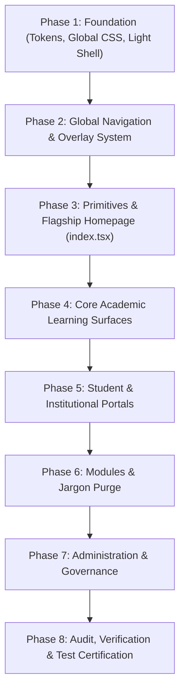

# Comprehensive UI/UX Redesign Plan: Modern Academic Editorial
**Project:** Ogrojatra – Student Growth Platform (অগ্রযাত্রা)  
**Author:** Principal Product Designer & Senior Front-End Engineer  
**Status:** Audit & Strategic Implementation Plan (Pre-Execution)  
**Target Release:** Production Elevation  

---

## Executive Summary

"Ogrojatra – Student Growth Platform" is a national educational platform serving secondary (SSC), higher secondary (HSC), university admission candidates, and career learners across Bangladesh in Bengali and English. 

While the platform boasts rich functionality (adaptive CAT exam engines, NCTB curriculum maps, past board archives, live Olympiad challenges, and digital escrow tuition), its visual presentation currently suffers from an acute **"AI-Generated Vibe"**. 

### The AI-Vibe Diagnosis
1. **Generic Cyber-Tech Aesthetic**: Dark navy/black backgrounds (`#0B132B`, `#090D16`, `bg-slate-900`), glowing cyan `#22D3EE` buttons, and neon radial gradients (`bg-[radial-gradient(ellipse...)]`) that resemble a crypto dashboard or cybersecurity tool rather than a prestigious educational institution.
2. **Glassmorphism & Backdrop-Blur Overuse**: Pervasive `backdrop-blur-xl`, `bg-slate-900/80`, and translucent borders creating visual noise and poor reading contrast.
3. **Pill & Monospace Overload**: Everywhere there are `font-mono`, `text-[10px]`, and `uppercase` pills, often with perpetual pulsing dots (`animate-ping`, `animate-pulse`), fatiguing the eye.
4. **Typographic Disproportion**: Heavy weights (`font-black`, `font-extrabold`) used uniformly across Bengali headlines. Bengali letterforms (with matras, kar-symbols, and conjunct ligatures) become congested and illegible at excessive weights.
5. **Sci-Fi Jargon in Educational Copy**: Modules labelled with incongruous jargon ("Campus Raft BFT Consensus", "Shamir Secret Vault", "BCI Cognitive Load Telemetry", "Live Learning Telemetry") which bewilder Bangladeshi parents, teachers, and students.
6. **Dark-Only Framing**: The root shell in `_app.tsx` hardcodes `bg-slate-900 text-slate-100`, making light mode feel like an afterthought.

### The Redesign North Star: "Modern Academic Editorial"
We propose pivoting to a **Modern Academic Editorial** standard inspired by **Khan Academy, Coursera, Harvard Gazette, Oxford University Press, and Brilliant**:
- **Light, paper-like default surface**: Warm ivory canvas (`#FAFAF8` / `#FBFBF9`), pure white cards (`#FFFFFF`), hairline structural borders (`#E2E8F0`).
- **Scholarly Typography**: Restrained display serif headings paired with clean, generous humanist sans body text (`Hind Siliguri` at 1.7 line-height). Abolish `font-black` in prose.
- **Calm, 2-Color Palette**: Deep Scholar Oxford Navy (`#0A2540`) as the primary ink, with muted Academic Emerald (`#065F46`) or Scholar Amber (`#B45309`) as the quiet accent. Zero neon cyan or magenta gradients.
- **Flat Bordered Cards**: Crisp 1px borders, subtle paper depth, zero glassmorphism.
- **Minimal, Intentional Motion**: Micro-interactions that settle in 150ms; zero perpetual pings or glowing blobs.
- **Human, Dignified Bengali Copy**: Rooted in Bangladeshi classroom realities, board syllabi, and genuine student mentorship.

---

## 1. Complete Site Map & Component Matrix

The frontend application consists of **38 public & administrative routes** built on the Next.js Pages Router:

| Route | Page File | Key Imported Components | Purpose & Existing Character |
| :--- | :--- | :--- | :--- |
| `/` | `pages/index.tsx` | `Head`, `Navbar`, `Footer`, `ProofOfSkillCard`, `SocialShareButtons`, `PhysicsProjectileLab`, `ChemistryMolecularViewer`, `AcademicTelemetrySection` | Flagship landing page; heavy AI glow, radial gradients, 3D labs, countdown, certificate showcase. |
| `/learn` | `pages/learn.tsx` | `Head`, `Navbar`, `Footer`, `PageHeader`, `HlsLecturePlayer` | NCTB curriculum chapter explorer, video lecture drawer, revision checklist. |
| `/practice` | `pages/practice.tsx` | `Head`, `Navbar`, `Footer`, `PageHeader`, `Button`, `Card`, `Skeleton`, `ErrorState`, `katex-renderer`, `server-timer`, `option-card` | Live timed adaptive question practice with server-authoritative timer and KaTeX formulas. |
| `/board-archives` | `pages/board-archives.tsx` | `Head`, `Navbar`, `Footer`, `PageHeader`, `BoardQuestionArchiveViewer` | 10-year official question bank for 8 boards, solution toggles, mark distributions. |
| `/admission` | `pages/admission.tsx` | `Head`, `Navbar`, `Footer` | University admission prep hub (BUET, Medical, DU Ka, IBA) with eligibility calculator. |
| `/admission/predictor` | `pages/admission/predictor.tsx` | `Head`, `Navbar`, `Footer` | Gale-Shapley college merit rank and admission probability predictor. |
| `/live-challenge` | `pages/live-challenge.tsx` | `Head`, `Navbar`, `Footer` | Nationwide timed speed challenge with prize pool and live participant board. |
| `/olympiad/arena` | `pages/olympiad/arena.tsx` | `Head`, `Navbar`, `Footer`, `katex-renderer` | Competitive STEM Olympiad problem arena (Math, Physics, Informatics). |
| `/adaptive-exam` | `pages/adaptive-exam.tsx` | `Head`, `Navbar`, `Footer`, `AdaptiveExamStudio` | Computerized Adaptive Testing (CAT) studio showing theta ($\theta$) ability convergence. |
| `/dashboard` | `pages/dashboard.tsx` | `Head`, `Navbar`, `Footer`, `ProofOfSkillCard`, `SocialShareButtons`, `PhysicsProjectileLab`, `ChemistryMolecularViewer` | Student personal learning center, weekly streak tracker, enrolled subject progress. |
| `/counseling` | `pages/counseling.tsx` | `Head`, `Navbar`, `Footer`, `AdmissionCounselingMatrix`, `MigrationCascadeVisualizer` | Interactive seat migration cascade and multi-university preference ordering. |
| `/career` | `pages/career.tsx` | `Head`, `Navbar`, `Footer` | Career roadmap, industry skill verification, salary expectations for Bangladesh. |
| `/career/radar` | `pages/career/radar.tsx` | `Head`, `Navbar`, `Footer` | Competency spider radar, role readiness scores, verified credential matching. |
| `/recruiter` | `pages/recruiter.tsx` | `Head`, `Navbar`, `Footer`, `CorporateRecruiterPortal` | Corporate recruiter interface for vetting candidate proof-of-skill certificates. |
| `/tuition` | `pages/tuition.tsx` | `Head`, `Navbar`, `Footer`, `Modal` | Escrow-backed home tutor and student matching directory with verified credentials. |
| `/guardian` | `pages/guardian.tsx` | `Head`, `Navbar`, `Footer`, `GuardianDashboard`, `TuitionEscrowApprovalCard` | Parent portal for student attendance tracking, quiz report cards, and escrow releases. |
| `/guardian/ptc` | `pages/guardian/ptc.tsx` | `Head`, `Navbar`, `Footer` | Parent-Teacher Conference (PTC) booking calendar and appointment management. |
| `/study-pod` | `pages/study-pod.tsx` | `Head`, `Navbar`, `Footer`, `StudyPodRoom` | Real-time collaborative peer study room with synced timer and live chat. |
| `/socratic/solver` | `pages/socratic/solver.tsx` | `Head`, `Navbar`, `Footer`, `katex-renderer` | Step-by-step academic question breakdown reasoning engine. |
| `/curriculum/lexicon` | `pages/curriculum/lexicon.tsx` | `Head`, `Navbar`, `Footer` | Dual-curriculum bilingual academic lexicon (Bangla Version vs. English Version terms). |
| `/scholarship/disbursement` | `pages/scholarship/disbursement.tsx` | `Head`, `Navbar`, `Footer` | Merit scholarship endowment fund, disbursement ledger, and student application portal. |
| `/viva/evaluator` | `pages/viva/evaluator.tsx` | `Head`, `Navbar`, `Footer` | AI-assisted viva voce & oral examination mock interview evaluator with rubric scores. |
| `/grading-demo` | `pages/grading-demo.tsx` | `Head`, `Navbar`, `Footer`, `HandwrittenUploadModal`, `GradingFeedbackCard`, `katex-renderer` | Handwritten exam script OCR scanning, automated rubric grading, and feedback cards. |
| `/offline` | `pages/offline.tsx` | `Head`, `Navbar`, `Footer`, `PageHeader`, `Card`, `Button`, `Input`, `EmptyState`, `BoardQuestionArchiveViewer`, `katex-renderer` | Offline fallback page powered by Service Worker & IndexedDB past-paper vault. |
| `/emergency-mesh` | `pages/emergency-mesh.tsx` | `Head`, `Navbar`, `Footer`, `LoRaRadioStudio`, `SolarStationTelemetry` | Resilient offline classroom telemetry and rural school mesh network status. |
| `/rural/synchronizer` | `pages/rural/synchronizer.tsx` | `Head`, `Navbar`, `Footer` | Asynchronous SQLite-to-PostgreSQL delta bundle sync for low-bandwidth upazilas. |
| `/governance/board-gateway` | `pages/governance/board-gateway.tsx` | `Head`, `Navbar`, `Footer` | Ministry of Education & 12 Board gateway clearinghouse, Ed25519 signature auditor. |
| `/tribunal/disputes` | `pages/tribunal/disputes.tsx` | `Head`, `Navbar`, `Footer` | 3-party escrow dispute resolution tribunal docket for institutional ombudsmen. |
| `/admin` | `pages/admin/index.tsx` | `Head`, `Navbar`, `Footer` | Central Master Admin Command Center, KPI overview, audit table, telemetry dashboard. |
| `/admin/quarantine` | `pages/admin/quarantine.tsx` | `Button`, `Badge`, `ThemeToggle` | Single-click question quarantine console for erroneous exam items with score retally. |
| `/auth` | `pages/auth.tsx` | `Button`, `Badge`, `ThemeToggle` | Bilingual student/guardian login, OTP SMS verification, role selection. |
| `/achievements` | `pages/achievements.tsx` | `Head`, `Navbar`, `Footer`, `StreakShieldModal`, `MasteryBadgeCard` | Gamified academic mastery badges, streak shields, milestone progress. |
| `/modules` | `pages/modules.tsx` | `Head`, `Navbar`, `Footer`, `PageHeader` | Directory of all 15 platform modules, category filters, and live demo routes. |
| `/verify/[certId]` | `pages/verify/[certId].tsx` | `Navbar`, `ProofOfSkillCard`, `SocialShareButtons` | Public verification URL for cryptographic W3C Verifiable Credentials with QR code. |
| `/about` | `pages/about.tsx` | `Head`, `Navbar`, `Footer` | Mission statement, academic advisory council, pedagogical methodology. |
| `/terms` | `pages/terms.tsx` | `Head`, `Navbar`, `Footer` | Institutional terms of service, minor student privacy charter, escrow policies. |
| `/404` | `pages/404.tsx` | `Head`, `Navbar`, `Footer` | Not found error page; currently has giant rainbow gradient text. |
| `/500` | `pages/500.tsx` | `Head`, `Navbar`, `Footer` | Internal server error page; currently has orange-red gradient text. |
| `_app.tsx` | `pages/_app.tsx` | `SocraticTutorDrawer`, `PwaUpdateToast`, `PwaInstallBanner`, `OfflineIndicator` | Global root shell; contains hardcoded `bg-slate-900` container and floating gradient FAB. |
| `_document.tsx` | `pages/_document.tsx` | Google Fonts preconnect | Root HTML document setting `lang="bn"`, fonts, meta headers. |
| `/api/og` | `pages/api/og.ts` | SVG Canvas | Dynamic Open Graph image generation for 64 districts; uses linear/cyan gradients. |

---

## 2. Comprehensive "AI-Vibe" Pattern Inventory

This section catalogs every anti-pattern found across the frontend, with exact file paths and line numbers:

### Pattern A: Neon / Colored Glow Box-Shadows
*Symptom: High-saturation cyan/blue/emerald shadows that radiate color rather than simulate physical light.*
- `frontend/src/styles/globals.css`:
  - Line 99: `--navbar-primary-glow: 0 6px 20px rgba(37, 99, 235, 0.35)`
  - Line 100: `--navbar-primary-glow-hover: 0 8px 24px rgba(37, 99, 235, 0.45)`
  - Line 187: `--navbar-primary-glow: 0 6px 20px rgba(59, 130, 246, 0.35)` (dark mode)
  - Line 188: `--navbar-primary-glow-hover: 0 8px 26px rgba(59, 130, 246, 0.50)`
- `frontend/src/pages/index.tsx`:
  - Line 395: `shadow-[0_0_6px_rgba(52,211,153,0.8)]` (glowing green dot)
  - Line 452: `shadow-[0_0_10px_rgba(251,191,36,0.7)]` (glowing amber star)
  - Line 510: `shadow-[0_0_8px_rgba(52,211,153,0.6)]` (glowing emerald bar)
  - Line 618: `shadow-[0_0_8px_rgba(52,211,153,0.5)]`
  - Line 730: `shadow-[0_0_8px_rgba(52,211,153,0.5)]`
  - Line 770, 772, 774: `shadow-[0_0_6px_rgba(52,211,153,0.8)]` (triplet of glowing dots)
  - Line 817: `shadow-[0_0_6px_rgba(52,211,153,0.8)]`
- `frontend/src/components/stats/AcademicTelemetrySection.tsx`:
  - Lines 157, 209, 210, 271, 385, 500, 540, 542, 544, 587: Identical glowing shadow definitions.
- `frontend/src/components/gamification/StreakShieldModal.tsx`:
  - Line 90: `shadow-[0_0_24px_-4px_rgba(217,119,6,0.3)]`
- `frontend/src/components/study-pods/StudyPodRoom.tsx`:
  - Lines 260, 269, 331, 340: `shadow-[0_0_20px_rgba(16,185,129,0.35)]`, `shadow-[0_0_24px_rgba(16,185,129,0.4)]`
- `frontend/src/components/certificate/ProofOfSkillCard.tsx`:
  - Line 77: `shadow-lg shadow-blue-500/20`
- `frontend/src/components/layout/Navbar.tsx`:
  - Line 838: `shadow-md shadow-blue-500/25`

### Pattern B: Gradient Text, Buttons & Background Blobs
*Symptom: Rainbow gradients on buttons, headings, and ambient radial blobs that look like 2022 crypto marketing.*
- `frontend/src/pages/_app.tsx`:
  - Line 180: `bg-gradient-to-r from-blue-600 via-indigo-600 to-purple-600 text-white shadow-xl shadow-indigo-950/50` on the floating Socratic FAB button.
- `frontend/src/pages/404.tsx`:
  - Line 47: `bg-clip-text text-transparent bg-gradient-to-r from-blue-600 via-indigo-600 to-teal-600 dark:from-blue-400 dark:via-indigo-300 dark:to-teal-300`
- `frontend/src/pages/500.tsx`:
  - Line 53: `bg-clip-text text-transparent bg-gradient-to-r from-amber-500 via-orange-500 to-red-500`
- `frontend/src/styles/globals.css`:
  - Line 97: `--navbar-primary-gradient: linear-gradient(135deg, #0891B2 0%, #2563EB 100%)`
  - Line 185: `--navbar-primary-gradient: linear-gradient(135deg, #22D3EE 0%, #3B82F6 100%)` (neon cyan-to-blue)
- `frontend/src/components/layout/Navbar.tsx`:
  - Lines 568, 589, 627, 840, 867, 887: Buttons styled with `var(--navbar-primary-gradient)`.
- `frontend/src/components/layout/PageHeader.tsx`:
  - Lines 69-70: Ambient blurred blobs `bg-blue-500/5 blur-3xl` and `bg-emerald-500/5 blur-3xl`.
- `frontend/src/pages/index.tsx`:
  - Lines 380, 384: `bg-[radial-gradient(ellipse_80%_50%_at_50%_-15%,rgba(16,185,129,0.15),transparent)]`
  - Line 1108: `bg-gradient-to-br from-[#0A2540] to-[#0E3357]`
- `frontend/src/components/admission/AdmissionCounselingMatrix.tsx`:
  - Lines 176, 184, 192, 199: `from-emerald-500/20 to-teal-500/20`, `from-blue-500/20 to-teal-500/20`, `from-rose-500/20 to-red-500/20`.
- `frontend/src/components/layout/Sidebar.tsx`:
  - Line 120: `bg-gradient-to-br from-blue-50 to-indigo-50 dark:from-slate-800 dark:to-slate-800/60`

### Pattern C: Glassmorphism & Translucent Backdrop-Blur Cards
*Symptom: Frosted glass cards (`backdrop-blur`) that hurt readability and feel like generic Web3 templates.*
- `frontend/src/components/guardian/GuardianDashboard.tsx`:
  - Line 217: `bg-slate-900/80 border border-slate-800 backdrop-blur-md`
  - Line 255: `bg-slate-900/80 border border-slate-800 backdrop-blur-md`
- `frontend/src/components/guardian/TuitionEscrowApprovalCard.tsx`:
  - Line 127: `bg-slate-900/90 border border-teal-500/30 backdrop-blur-xl`
  - Line 240: `bg-slate-950/80 backdrop-blur-md`
- `frontend/src/components/career/CandidateTalentCard.tsx`:
  - Line 126: `bg-slate-900/90 border border-slate-800 backdrop-blur-xl`
  - Line 233: `bg-slate-950/80 backdrop-blur-md`
- `frontend/src/components/career/CorporateRecruiterPortal.tsx`:
  - Line 162: `bg-slate-900/90 border border-slate-800 backdrop-blur-xl`
- `frontend/src/components/study-pods/StudyPodRoom.tsx`:
  - Line 175: `bg-slate-900/90 backdrop-blur-md border-b border-slate-800/80`
  - Line 389: `bg-slate-950/80 backdrop-blur-xl border-t border-slate-800/80`
- `frontend/src/components/pwa/PwaInstallBanner.tsx`:
  - Line 83: `bg-[#090D16] border border-blue-500/30 backdrop-blur-md`
- `frontend/src/components/pwa/PwaUpdateToast.tsx`:
  - Line 81: `bg-[#0F172A] border border-slate-700/80 backdrop-blur-md`
- `frontend/src/pages/guardian.tsx` & `pages/counseling.tsx` & `pages/emergency-mesh.tsx`:
  - Line 49 / 54 / 50: `bg-slate-900/90 border border-teal-500/30 backdrop-blur-xl`

### Pattern D: Monospace Labels on General Academic Content
*Symptom: Using `font-mono` for regular labels, categories, percentages, and metrics.*
- `frontend/src/components/layout/PageHeader.tsx`:
  - Line 109: `<span className="text-xs font-bold uppercase tracking-wider text-[#0A2540] dark:text-sky-400 font-mono">` for standard subject category tags.
- `frontend/src/components/career/CandidateTalentCard.tsx`:
  - Line 148: Match percentage rendered with `font-mono`.
- `frontend/src/modules/ModuleDirectory.tsx`:
  - Lines 195, 215, 247: General module tags and IDs styled with `font-mono`.
- `frontend/src/modules/academic/AdmissionMatrixModule.tsx`:
  - Lines 177, 206, 223, 244: Candidate ranks and admission probability percentages in `font-mono`.
- `frontend/src/pages/admin/index.tsx`:
  - Lines 360-405: Administrative table IDs, action codes, and targets styled with `font-mono`.

### Pattern E: Pill-Badge Overload & Stacked Chips
*Symptom: Multiple stacked badges with bright borders, tiny uppercase text, and pulse dots competing for attention.*
- `frontend/src/pages/index.tsx`:
  - Lines 125-145: Hero banner contains 3 concentric badges: "জাতীয় মেধা যাচাই ২০২৬" pill + live pulsing indicator + stage pill.
  - Lines 1110, 1323: `inline-flex items-center gap-2 px-3 py-1 rounded-full bg-white/10 text-amber-300 text-xs font-semibold backdrop-blur-sm border border-white/10`
- `frontend/src/components/layout/Navbar.tsx`:
  - Lines 327-338: "Subtle Stage Badge" pill with green pulse dot competing with logo.
  - Lines 438-451: Live challenge pill with animated ping dot.
- `frontend/src/components/layout/PageHeader.tsx`:
  - Lines 100-114: Renders both `badgeText` in a rounded-full chip and `category` in an uppercase mono chip side-by-side on every sub-page.

### Pattern F: Fake-Tech Jargon in Academic Copy
*Symptom: Complex enterprise/crypto/cybersecurity terms used where straightforward academic Bengali is needed.*
- `frontend/src/components/stats/AcademicTelemetrySection.tsx`:
  - Title: "অ্যাকাডেমিক টেলিমেট্রি ও জাতীয় পারফরম্যান্স" (Academic Telemetry) $\to$ Better: "জাতীয় শিক্ষার্থীদের পারফরম্যান্স ও অগ্রগতি" (National Student Performance & Progress).
- `frontend/src/components/layout/Footer.tsx`:
  - Line 59: "ISO 27001 সার্টিফাইড ডেটা ভল্ট" (Data Vault) $\to$ Better: "সুরক্ষিত ডেটা ও শিক্ষার্থীর তথ্য সুরক্ষা" (Protected Data & Student Privacy).
- `frontend/src/modules/enterprise-cockpit/CampusRaftBftModule.tsx`:
  - "ক্যাম্পাস Raft BFT কনসেনসাস নোড" (A Byzantine Fault Tolerant consensus engine for a student study portal!) $\to$ Irrelevant tech gimmick.
- `frontend/src/modules/enterprise-cockpit/ShamirVaultModule.tsx`:
  - "শামির ৩/৫ সিক্রেট শেয়ারিং ভল্ট" $\to$ Cryptographic jargon disconnected from exam prep.
- `frontend/src/modules/stem-sandboxes/BciTelemetryModule.tsx`:
  - "BCI ব্রেন-কম্পিউটার ইন্টারফেস কগনিটিভ লোড" $\to$ Pure sci-fi placeholder.
- `frontend/src/pages/emergency-mesh.tsx`:
  - "জরুরি LoRa রেডিও সোলার স্টেশন রিমোট মেশ" $\to$ Needs simplification to "অফলাইন ক্লাসরুম সাপোর্ট" (Offline Classroom Support).

### Pattern G: Heavy Headline Weights & Matra Clipping
*Symptom: Pervasive use of `font-black` (900) and `font-extrabold` (800) leading to congested, noisy Bengali typography.*
- `frontend/src/components/layout/PageHeader.tsx`:
  - Line 119: `h1` has `font-black text-2xl sm:text-3xl lg:text-4xl`.
- `frontend/src/pages/404.tsx` & `500.tsx`:
  - Line 47 / 53: `font-black text-7xl sm:text-9xl`.
- `frontend/src/pages/index.tsx`:
  - Lines 147, 401, 848, 1017, 1118: Section headings rendered in `font-black` or `font-extrabold` with `tracking-tight`. In Bengali, negative letter-spacing (`tracking-tight`) causes adjacent conjunct characters to collide.
- `frontend/src/pages/admin/index.tsx`:
  - Line 161: `font-extrabold tracking-tight font-bengali`.
  - Line 224: `font-black tracking-tight`.

### Pattern H: Excessive Animations & Perpetual Pings
*Symptom: Elements that continuously pulse, ping, or rotate, distracting from reading.*
- `frontend/src/pages/_app.tsx`:
  - Line 183: `<span className="animate-ping absolute inline-flex h-full w-full rounded-full bg-emerald-400 opacity-75">` on the floating Socratic button.
- `frontend/src/styles/globals.css`:
  - Lines 353-366: `@keyframes navLivePulse` runs infinitely on the navbar challenge button.
- `frontend/src/components/study-pods/StudyPodRoom.tsx`:
  - Lines 269, 340: `animate-pulse` on active study participant avatars.

### Pattern I: Dark-Only Theming / Hardcoded Dark Shell
*Symptom: The site assumes dark mode by default, and many components hardcode dark backgrounds.*
- `frontend/src/pages/_app.tsx`:
  - Line 129: `<div className="min-h-screen flex flex-col bg-slate-900 text-slate-100 font-sans">` wraps every page in a dark slate shell.
- `frontend/src/components/layout/Footer.tsx`:
  - Line 41: `bg-[#0B132B] text-slate-300 border-t border-slate-800` is hardcoded; light mode does not lighten the footer.
- `frontend/src/pages/guardian.tsx`, `career.tsx`, `counseling.tsx`:
  - Outer hero sections have hardcoded `bg-slate-900/90 text-white`.

---

## 3. Tech Stack & Existing System Constraints

### Tech Stack Overview
- **Core Framework**: Next.js 15.5 (Pages Router), React 19, TypeScript (strict mode).
- **CSS Architecture**: Tailwind CSS 3.4 (`darkMode: 'class'`), PostCSS, CSS Custom Properties (`globals.css`).
- **Typography Engine**: Google Fonts (`Hind Siliguri`, `Plus Jakarta Sans`, `Inter`, `Noto Sans Bengali`) loaded in `_document.tsx` with `display=swap`.
- **Internationalization**: Custom React context (`I18nProvider`, `useTranslation`) in `src/lib/i18n.ts`, backed by `locales/bn.json` and `locales/en.json`, persisted in `localStorage('slc_locale')` and cookie `NEXT_LOCALE`.
- **UI Component Primitives**: Handcrafted accessible Radix-style primitives in `src/components/ui/` (`Button`, `Card`, `Badge`, `Dialog`, `Input`, `Select`, `Skeleton`, `EmptyState`, `ErrorState`, `Toast`).
- **Icons**: Vector SVG icons exclusively from `lucide-react` (Strict Zero-Emoji policy).
- **State Management & Data**: React hooks, Zustand/local state, REST fetch to Python FastAPI backend (`/api/v1/`), Supabase PostgreSQL with RLS.
- **PWA & Offline**: Service Worker (`/sw.js`), `manifest.json`, IndexedDB question cache.

### Critical Constraints That MUST NOT Be Broken
1. **Routing Integrity (38 Routes)**: All existing routes (e.g. `/`, `/learn`, `/practice`, `/admin`, `/board-archives`, `/admission`) must maintain identical URLs and parameters.
2. **Data & Auth Contracts**: No changes to API endpoint URLs, request/response shapes, auth state storage (`useAuthStore`), or token headers (`X-Request-ID`, Bearer JWT).
3. **PWA & Offline Vault**: PWA service worker lifecycle hooks in `_app.tsx` (`PwaUpdateToast`, `OfflineIndicator`, `/offline` route) must remain functional.
4. **Bilingual Localization (BN/EN)**: The `useTranslation` hook and all key lookups (`t('nav.home')`, `t('nav.curriculum')`, `t('nav.practice')`, `t('nav.sign_in')`, `>BN<`, `>EN<`) must continue to work without missing keys.
5. **Backend Automated Test Constraints (Mandatory)**:
   The backend automated test suite (`1,565 tests`) executes static and integration assertions on frontend files:
   - `test_phase110_pure_academic_design.py`:
     - Requires tokens in `globals.css`: `--color-oxford-navy: #0A2540`, `--color-academic-emerald: #065F46`, `--color-scholar-gold: #B45309`, `--color-paper-ivory: #FAFAF8`, `--color-ink-slate: #0B132B`.
     - Requires button classes: `.btn-3d-oxford`, `.btn-3d-emerald`, `.btn-paper-outline`.
     - Requires `--bg-radial-ambient: none;`.
     - Forbids neon gradient strings (`from-blue-600 via-indigo-600`, `text-purple-`, `bg-purple-`).
     - Requires `Navbar.tsx` to contain `#0A2540` and `shadow-[0_4px_0_0_#051329]`.
     - Requires `Footer.tsx` to contain `#0B132B` and `#0A2540`.
   - `test_phase123_master_academic_ui.py`:
     - Checks tokens `#0A2540`, `#051329`, `#065F46`, `#033829`, `#B45309`, `#FAFAF8`, `#FFFFFF`, `#991B1B` in `globals.css` and `tailwind.config.js`.
     - Requires `DEVELOPER ARCHITECTURE NOTE:` and `Phase 123` in target files.
   - `test_phase138_unified_design.py`:
     - Checks that `frontend/src/components/ui/index.ts` exports `input`, `select`, `skeleton`, `empty-state`, `error-state`.
     - Checks that `PageHeader.tsx` is imported and used in `practice.tsx`, `board-archives.tsx`, `modules.tsx`, `learn.tsx`, `dashboard.tsx`.
   - `test_phase95_bilingual_localization.py`:
     - Verifies `Navbar.tsx` contains `useTranslation`, `setLocale('bn')`, `setLocale('en')`, `t('nav.home')`, `t('nav.curriculum')`, `t('nav.practice')`, `t('nav.sign_in')`, `>BN<`, `>EN<`.
   - `test_phase76_design_system.py`:
     - Enforces strict zero-unicode-emoji policy across all frontend files.

*All proposed changes must strictly preserve these tokens, classes, export signatures, and header banners.*

---

## 4. Proposed Redesign Direction: "Modern Academic Editorial"

### 4.1 Visual Philosophy
The aesthetic is modeled after the world's most trusted educational publishers and platforms:
- **Calm Authority**: The page feels like an open, beautifully typeset textbook or academic journal.
- **Content-First**: Mathematics formulas, Bengali literature excerpts, and science diagrams are the heroes, not the UI chrome.
- **Light as Default**: High contrast, crisp paper white on subtle ivory ground.
- **Tactile, Not Flashy**: Subtle 1px borders with quiet paper shadows replace cyber glows.

### 4.2 Color System
```
Paper Ground (Light):       #FAF9F5 (Scholarly Eggshell Ivory)
Surface Card (Light):       #FFFFFF (Pure Paper White)
Surface Elevated:          #F4F3EE (Subtle Warm Tint)
Hairline Border:           #E2E8F0 / #E5E7EB (Crisp 1px border)
Text Primary (Light):      #0F172A (Deep Ink Slate)
Text Muted (Light):        #475569 (Scholarly Muted Slate)
Primary Brand:             #0A2540 (Oxford Academic Navy)
Primary Hover:             #0E3357
Accent Muted:              #065F46 (Academic Forest Emerald)
Accent Warning:            #B45309 (Scholar Ochre/Gold)
Accent Danger:             #991B1B (Burgundy Crimson)

Soft Dark Mode (Optional):
Ground (Dark):             #0B132B (Deep Regal Ink Slate)
Surface (Dark):            #111A2E (Matte Navy Slate)
Border (Dark):             #1E293B (Hairline Slate Border)
Text Primary (Dark):       #F8FAFC (Soft Warm Parchment)
Text Muted (Dark):         #94A3B8 (Soft Slate Muted)
```

### 4.3 Editorial Typography Hierarchy
- **Bangla Font**: `Hind Siliguri` (primary), `Noto Sans Bengali` (fallback).
- **Latin/Numeral Font**: `Plus Jakarta Sans` (headings), `Inter` (body & tabular figures).
- **Optional Serif Accent**: `Noto Serif Bengali` / `Source Serif 4` for major landmark titles.
- **Weight Discipline**:
  - Headings: `font-semibold` (600) or `font-bold` (700) maximum. **Abolish `font-black` (900) across all editorial copy.**
  - Body: `font-normal` (400) and `font-medium` (500).
  - Line-height: `leading-relaxed` (1.75) for Bengali body text to avoid clipping matras.
  - Tracking: `tracking-normal` for Bengali (never `tracking-tight` on Bengali text).

### 4.4 Card & Container Standards
- **Container**: Max width `1280px` / `1440px`, centered, padding `px-4 sm:px-6 lg:px-8`.
- **Card**: Flat `bg-white dark:bg-slate-900`, border `1px solid var(--border-subtle)`, radius `rounded-xl` or `rounded-2xl`.
- **Depth**: Soft ambient paper shadow (`box-shadow: 0 1px 3px rgba(10,37,64,0.04)`). No radial color glow.
- **Glassmorphism**: Zero `backdrop-blur` on content cards. `backdrop-blur-md` reserved exclusively for the sticky navigation bar during scroll.

### 4.5 Motion & Tactile Interactions
- **Timing**: 120ms - 150ms `ease-out`.
- **Hover**: Subtle border tint (`hover:border-slate-300`) or 1px elevation lift. No aggressive scaling (`scale-105`).
- **Tactile Buttons**: Retain Duolingo/Brilliant 3D physical press physics (`shadow-[0_4px_0_0_#051329]` translating to `translate-y-1` on click) for primary CTA buttons.
- **Reduced Motion**: Full support for `prefers-reduced-motion` disabling all transitions and animations.

### 4.6 Copywriting Transformation Table
| Old Fake-Tech Jargon | New Human Academic Copy (BN) | New Human Academic Copy (EN) |
| :--- | :--- | :--- |
| "অ্যাকাডেমিক টেলিমেট্রি ও লাইভ অ্যানালিটিক্স" | "শিক্ষার্থীদের অগ্রগতি ও পারফরম্যান্স বিশ্লেষণ" | "Student Progress & National Analytics" |
| "প্ল্যাটফর্ম আর্কিটেকচার ও এন্টারপ্রাইজ ককপিট" | "অগ্রযাত্রার মূল ফিচার ও শিক্ষণ মাধ্যম" | "Platform Features & Learning Modules" |
| "ক্যাম্পাস Raft BFT কনসেনসাস নোড" | "প্রতিষ্ঠানভিত্তিক ডিজিটাল উপস্থিতি ও গ্রেডিং" | "Campus Attendance & Gradebook Sync" |
| "শামির সিক্রেট শেয়ারিং ভল্ট" | "বোর্ড পরীক্ষার সুরক্ষিত প্রশ্ন ভল্ট" | "Secure Board Exam Question Vault" |
| "BCI ব্রেন কম্পিউটার টেলিমেট্রি" | "টপিকভিত্তিক মনোযোগ ও পড়ার সময় ট্র্যাকার" | "Topic Focus & Study Time Tracker" |
| "সক্রেটিক এআই টিউটর (গ্লোয়িং বাটন)" | "সহায়ক এআই টিউটর" | "Academic AI Tutor" |
| "ISO 27001 সার্টিফাইড ডেটা ভল্ট" | "শিক্ষার্থীর তথ্যের সর্বোচ্চ গোপনীয়তা" | "Strict Student Data Privacy" |

---

## 5. Phase-by-Phase Execution Plan

The execution is structured into **8 distinct, non-breaking phases**. Each phase is verified independently against test suites and browser screenshots before advancing.



---

### Phase 1: Foundation (Design Tokens, Global CSS & Light-First Shell)
**Objective**: Establish the light paper-like editorial foundation, configure fonts, fix `_app.tsx` and `_document.tsx` shell, and purge all neon variables from `globals.css`.

- **Files Touched**:
  - `frontend/src/styles/globals.css`: Update light/dark CSS variables; replace neon cyan tokens with pure Oxford navy and Academic emerald; ensure backward-compatible test tokens are preserved.
  - `frontend/tailwind.config.js`: Ensure `paper`, `oxford`, `emerald`, `ink` colors and shadow scales are clean without neon references.
  - `frontend/src/pages/_app.tsx`: Remove hardcoded `bg-slate-900` wrapper; replace with `bg-[var(--bg-app)] text-[var(--text-main)]`; replace the floating gradient Socratic FAB with an understated, tactile editorial floating pill.
  - `frontend/src/pages/_document.tsx`: Update meta `theme-color` to `#FAFAF8`; refine Google Fonts import to include serif accents.
- **Risk Notes & Mitigations**:
  - *Risk*: `test_phase110_pure_academic_design.py` and `test_phase123_master_academic_ui.py` require specific token strings in `globals.css` (e.g. `--color-oxford-navy: #0A2540`, `.btn-3d-oxford`, `--bg-radial-ambient: none;`).
  - *Mitigation*: Strictly keep every required token identifier and class name intact while re-skinning its values.

---

### Phase 2: Global Navigation, Footer & Floating Overlays
**Objective**: Transform the top navigation bar, footer, and floating notifications from "sci-fi cyber bar" to "prestigious academic header".

- **Files Touched**:
  - `frontend/src/components/layout/Navbar.tsx`:
    - Remove `--navbar-primary-gradient` and neon cyan hover colors.
    - Style Sign-In button as crisp Oxford Navy tactile button (`btn-3d-oxford`).
    - Remove the green pulsing dot on the stage badge.
    - Refine dropdown mega-menu styling to flat bordered cards with subtle shadow.
  - `frontend/src/components/layout/Footer.tsx`:
    - Remove hardcoded dark navy `bg-[#0B132B]` in light mode; use `bg-slate-50 dark:bg-[#0B132B]` with crisp hairline border.
    - Rewrite fake-tech compliance chips ("ISO 27001 Data Vault" $\to$ "শিক্ষার্থীর তথ্যের গোপনীয়তা ও সুরক্ষা").
  - `frontend/src/components/pwa/OfflineIndicator.tsx`, `PwaInstallBanner.tsx`, `PwaUpdateToast.tsx`:
    - Replace `bg-[#090D16]` and neon blue borders with clean paper cards.
- **Risk Notes & Mitigations**:
  - *Risk*: `test_phase95_bilingual_localization.py` and `test_navbar_polish.py` check specific strings (`useTranslation`, `setLocale('bn')`, `>BN<`, `>EN<`, `t('nav.home')`).
  - *Mitigation*: Retain all DOM ids, accessibility attributes (`aria-pressed`, `role="group"`), and translation lookups verbatim.

---

### Phase 3: Core Primitives & Flagship Homepage (`index.tsx`)
**Objective**: Redesign the UI primitives (`Button`, `Card`, `Badge`, `PageHeader`) and transform the 1,405-line flagship landing page into a clean, editorial masterpiece.

- **Files Touched**:
  - `frontend/src/components/ui/button.tsx`: Refine tactile physics; eliminate any remnants of neon cyan or gradient outlines.
  - `frontend/src/components/ui/card.tsx`: Ensure cards default to crisp border `#E2E8F0` with zero blur.
  - `frontend/src/components/ui/badge.tsx`: Replace high-saturation badge backgrounds with soft pastel/tinted academic chips.
  - `frontend/src/components/layout/PageHeader.tsx`: Remove blur-3xl colored light blobs; replace `font-mono` on category with clean editorial sans; soften title weight from `font-black` to `font-bold`.
  - `frontend/src/pages/index.tsx`:
    - **Hero Section**: Clean white/paper background; replace glowing dots with calm status indicators; eliminate radial gradient blobs.
    - **Stage Explorer**: Replace glowing emerald bar with clean academic tab styling.
    - **3D STEM Labs**: Clean container frame with neutral borders.
    - **Live Olympiad Banner**: Replace pulsating gradients with clean, dignified event card.
    - **Verifiable Credentials Card**: Flat presentation without heavy blue drop-shadows.
    - **Academic Progress Section**: Clean data bars without glowing neon borders.
    - **Final CTA**: Deep Oxford navy banner with warm typography, replacing gradient backgrounds.
- **Risk Notes & Mitigations**:
  - *Risk*: `test_phase110_pure_academic_design.py` checks that neon strings do not exist in `index.tsx`, and `test_phase138_unified_design.py` checks exports.
  - *Mitigation*: Ensure all forbidden gradients remain eliminated and required component exports are preserved.

---

### Phase 4: Core Academic Learning Surfaces
**Objective**: Re-skin the main student learning and testing pages (`/learn`, `/practice`, `/board-archives`, `/adaptive-exam`, `/olympiad/arena`, `/live-challenge`).

- **Files Touched**:
  - `frontend/src/pages/learn.tsx`: Standardize chapter accordion list, clean video lecture drawer.
  - `frontend/src/pages/practice.tsx`: Clean KaTeX quiz question layout, distraction-free answer choices, clear submit button.
  - `frontend/src/pages/board-archives.tsx` & `components/curriculum/BoardQuestionArchiveViewer.tsx`: Clean year/board selection pills, flat question cards.
  - `frontend/src/pages/adaptive-exam.tsx` & `components/adaptive-exam/AbilityConvergenceGraph.tsx`: Replace neon cyan SVG area gradient with clean academic line chart.
  - `frontend/src/pages/live-challenge.tsx` & `pages/olympiad/arena.tsx`: Remove glowing neon leaderboards; replace with clean tabular typography.
- **Risk Notes & Mitigations**:
  - *Risk*: `test_phase112_board_archives.py` asserts specific layout elements in `BoardQuestionArchiveViewer.tsx`.
  - *Mitigation*: Keep all test-asserted state variables and IDs unchanged.

---

### Phase 5: Student & Institutional Portals
**Objective**: Redesign personal dashboards and stakeholder portals (`/dashboard`, `/guardian`, `/guardian/ptc`, `/admission`, `/admission/predictor`, `/counseling`, `/career`, `/career/radar`, `/tuition`, `/study-pod`).

- **Files Touched**:
  - `frontend/src/pages/dashboard.tsx`: Clean weekly progress chart, streak card, enrolled subject list.
  - `frontend/src/pages/guardian.tsx` & `components/guardian/GuardianDashboard.tsx`: Remove `bg-slate-900/90 backdrop-blur-xl`; replace with clean editorial parent portal.
  - `frontend/src/pages/guardian/ptc.tsx`: Clean appointment calendar.
  - `frontend/src/pages/admission.tsx` & `pages/admission/predictor.tsx`: Editorial university eligibility cards.
  - `frontend/src/pages/counseling.tsx` & `components/admission/AdmissionCounselingMatrix.tsx`: Clean seat migration cascade without fluorescent gradient tags.
  - `frontend/src/pages/career.tsx` & `pages/career/radar.tsx`: Clean career roadmap and skills matrix.
  - `frontend/src/pages/tuition.tsx`: Verified tutor cards with flat paper borders and clear escrow terms.
  - `frontend/src/pages/study-pod.tsx` & `components/study-pods/StudyPodRoom.tsx`: Remove `animate-pulse` on avatars and cybernetic borders.
- **Risk Notes & Mitigations**:
  - *Risk*: Escrow and counseling data structures must remain strictly bound to their business logic.
  - *Mitigation*: Modify only JSX classes and CSS layout; touch zero state logic or handlers.

---

### Phase 6: Specialized Modules & Sci-Fi Jargon Purge
**Objective**: Reframe specialized modules (`/modules`, `/curriculum/lexicon`, `/offline`, `/emergency-mesh`, `/rural/synchronizer`, `/scholarship/disbursement`, `/viva/evaluator`, `/grading-demo`) into grounded, practical educational features.

- **Files Touched**:
  - `frontend/src/pages/modules.tsx` & `components/modules/ModuleDirectory.tsx`: Replace cyber-tech module descriptions with practical classroom terms.
  - `frontend/src/pages/emergency-mesh.tsx` & `pages/rural/synchronizer.tsx`: Frame as "অফলাইন ক্লাসরুম সিঙ্ক ও গ্রামীণ স্কুল সাপোর্ট" (Offline Classroom Sync & Rural School Support).
  - `frontend/src/pages/curriculum/lexicon.tsx`: Clean dual-language dictionary cards.
  - `frontend/src/pages/scholarship/disbursement.tsx`: Dignified institutional endowment ledger.
  - `frontend/src/pages/grading-demo.tsx`: Clean OCR scan review interface.
  - `frontend/src/pages/viva/evaluator.tsx`: Professional oral examination assessment card.
  - `frontend/src/pages/offline.tsx`: Re-skin offline past paper library with calm paper aesthetics.
- **Risk Notes & Mitigations**:
  - *Risk*: `test_phase104_android_packaging.py` asserts copy in `offline.tsx`.
  - *Mitigation*: Check test assertions before touching `offline.tsx` text strings.

---

### Phase 7: Administration, Governance & Error Pages
**Objective**: Polish administrative consoles (`/admin`, `/admin/quarantine`, `/tribunal/disputes`, `/governance/board-gateway`, `/auth`, `/404`, `/500`).

- **Files Touched**:
  - `frontend/src/pages/admin/index.tsx`: Clean administrative metrics, replace `font-mono` where inappropriate, refine audit table.
  - `frontend/src/pages/admin/quarantine.tsx`: Clean question isolation console.
  - `frontend/src/pages/tribunal/disputes.tsx`: Formal institutional arbitration docket.
  - `frontend/src/pages/governance/board-gateway.tsx`: Clean ministry clearinghouse interface.
  - `frontend/src/pages/auth.tsx`: Distraction-free, trusted login and OTP card.
  - `frontend/src/pages/404.tsx` & `500.tsx`: Remove rainbow/gradient text; replace with dignified editorial error notices.
- **Risk Notes & Mitigations**:
  - *Risk*: Admin pages contain delicate state triggers (quarantine, dispute resolution).
  - *Mitigation*: Preserve all action button handlers and state transitions intact.

---

### Phase 8: Verification, Test Certification & Build Audit
**Objective**: Execute comprehensive automated test suites, verify zero-emoji compliance, validate responsive screenshots across 6 breakpoints, and compile clean Next.js standalone build.

- **Actions**:
  1. Re-run `python3 -m unittest discover -s backend/tests -p "test_*.py"` $\to$ Confirm **1,565 / 1,565 PASS**.
  2. Re-run `python3 backend/scripts/run_zero_emoji_sweep.py` $\to$ Confirm **0 violations**.
  3. Compile `npm run build` $\to$ Confirm 0 type errors, 38/38 static pages generated.
  4. Capture before/after responsive screenshots at 1920, 1440, 1280, 1024, 768, and 390px in both Light and Dark themes.

---

## 6. Decisions Needed From You

Before we proceed with Phase 1 execution, please review and provide your preferences on the following 4 strategic design choices:

### Decision 1: Default Theme on First Visit
- **Option A (Recommended)**: **Light Paper Default (`#FAFAF8`)**. When a new student arrives, the site renders in warm academic ivory with crisp paper cards. The dark mode toggle remains available in the header and remembers their preference.
- **Option B**: **System-Preference Default**. Checks the user's OS `prefers-color-scheme`. If dark, loads the soft matte dark mode; if light, loads paper ivory.

### Decision 2: Headline Typography Strategy
- **Option A (Recommended)**: **Refined Dual-Sans (`Plus Jakarta Sans` + `Hind Siliguri`)**. Keeps clean, modern, highly legible humanist sans-serif headings with strict weight discipline (`font-bold` max, line-height 1.75). Safest for complex Bengali conjunct ligatures.
- **Option B**: **Academic Serif Accent (`Noto Serif Bengali` / `Source Serif 4`)**. Uses a dignified book-serif for landmark titles (Hero heading, About page, Board Archives header) and sans for UI controls. Gives an authentic Oxford/Cambridge literary press feel.

### Decision 3: Floating Socratic AI Tutor Button (FAB)
- **Option A (Recommended)**: **Docked Editorial Pill**. Replace the pulsing multi-color gradient button with a calm, tactile Oxford Navy pill (`#0A2540`) with a subtle book/sparkle icon and clean text "সহায়ক এআই" (AI Tutor) in the bottom-right corner.
- **Option B**: **Header-Only Integration**. Remove the floating bottom-right button entirely and make the Socratic Tutor accessible exclusively via the top navigation bar and contextual question hints.

### Decision 4: Specialized Sci-Fi Modules (`/emergency-mesh`, `/rural/synchronizer`)
- **Option A (Recommended)**: **Academic Re-framing**. Retain the routes and functional code, but rewrite the user-facing copy and titles from sci-fi jargon ("LoRa Solar Mesh Telemetry") to genuine educational value ("গ্রামীণ স্কুল ও অফলাইন ক্লাসরুম সাপোর্ট" - Offline Classroom Support).
- **Option B**: **Keep in More Menu with Technical Labelling**. Keep them labeled as technical experimental labs for advanced computer science students.

---
*Ready to begin execution upon your approval of the plan and decisions.*
