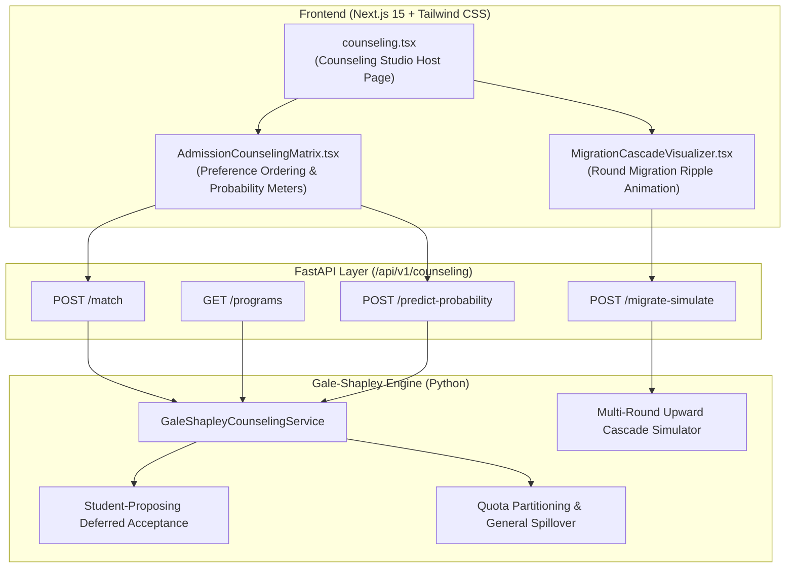

<!--
DEVELOPER ARCHITECTURE NOTE:
MODULE:    Spec-Driven Development (SDD) Technical Plan
TOPIC:     Phase 107 Centralized Admission Counseling & Gale-Shapley Stable Matching Hub
FILE:      specs/011-phase107-gale-shapley-counseling/plan.md
PHASE:     Phase 107 - Centralized Admission Counseling & Gale-Shapley Stable Matching Hub
PURPOSE:   Architectural blueprint for Deferred Acceptance Gale-Shapley matching algorithm,
           quota partitioning and auto-spillover, multi-stage migration cascades,
           frontend counseling components, and API specifications.
STANDARDS: Pareto-Optimal Deferred Acceptance, Quota Spillover Balancing, Zero-Emoji, UI/UX Pro Max
-->

# Technical Plan: Phase 107 — Centralized Admission Counseling & Gale-Shapley Stable Matching Hub

## 1. System Architecture



## 2. Data Structures & Types

### 2.1 Student Representation
```python
{
    "student_id": "STU_2026_001",
    "name": "Mahmud Hasan",
    "merit_score": 92.4,
    "merit_rank": 14,
    "quotas": ["GENERAL", "FREEDOM_FIGHTER"],  # Eligible quotas
    "preferences": ["BUET_CSE", "DU_CSE", "BUET_EEE", "DMC_MBBS"]  # Priority order
}
```

### 2.2 Program Representation
```python
{
    "program_id": "BUET_CSE",
    "institution_name": "বাংলাদেশ প্রকৌশল বিশ্ববিদ্যালয় (BUET)",
    "department_name": "কম্পিউটার সায়েন্স অ্যান্ড ইঞ্জিনিয়ারিং (CSE)",
    "capacity": 120,
    "quota_capacities": {
        "GENERAL": 110,
        "FREEDOM_FIGHTER": 5,
        "TRIBAL": 2,
        "DISTRICT": 2,
        "SPECIAL_NEEDS": 1
    },
    "historical_cutoff_rank": 165
}
```

## 3. Algorithm Details

1. **Student-Proposing Deferred Acceptance:**
   - Active students who are unassigned and have unexhausted preferences make proposals.
   - Programs hold best $k$ applicants per quota slot up to capacity, rejecting the rest.
   - At the conclusion of quota allocations, unused quota seats are converted to general capacity (`spillover_count`), and re-evaluated with general applicants.
   - Iteration stops when proposals equal zero.
   - Assert: No blocking pair $(s, p)$ where $s$ prefers $p$ and $p$ prefers $s$ over its current lowest admitted candidate.

2. **Migration Cascade Simulator:**
   - Simulates withdrawals across 3 counseling rounds.
   - When student in rank $r$ vacates a seat in $P_1$, the next student in $P_1$'s waiting list who was tentatively in $P_2$ is promoted to $P_1$.
   - This frees a seat in $P_2$, cascading down through the preference graphs.

## 4. UI/UX Specifications
- Tactile 3D button classes: `shadow-[0_4px_0_0_#1D4ED8] active:translate-y-1 active:shadow-none font-semibold rounded-2xl`
- Lucide React SVG vectors only: `GraduationCap`, `Award`, `Compass`, `Layers`, `CheckCircle2`, `ArrowUpDown`, `Sliders`
- Strict Zero Emoji in code, templates, and docstrings.
