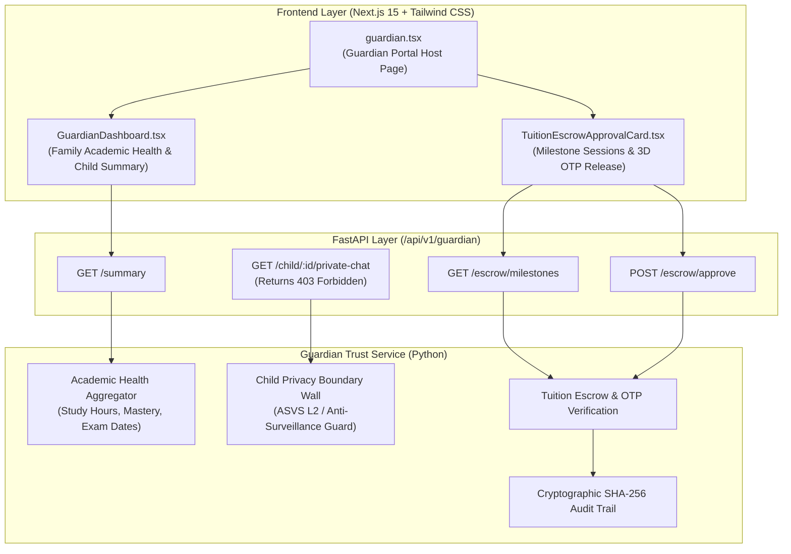

<!--
DEVELOPER ARCHITECTURE NOTE:
MODULE:    Spec-Driven Development (SDD) Technical Plan
TOPIC:     Phase 108 Guardian Trust Console & Child Digital Safety Portal
FILE:      specs/012-phase108-guardian-trust-console/plan.md
PHASE:     Phase 108 - Guardian Trust Console & Child Digital Safety Portal
PURPOSE:   Architectural blueprint for guardian academic telemetry aggregation,
           child digital privacy boundary wall enforcement, tuition escrow release workflows,
           and cryptographic audit trails.
STANDARDS: ASVS L2 Minor Privacy Boundary, Zero-Intrusion Safeguards, Zero-Emoji, UI/UX Pro Max
-->

# Technical Plan: Phase 108 — Guardian Trust Console & Child Digital Safety Portal

## 1. System Architecture

## 2. Child Privacy Boundary Wall (ASVS L2 Standard)
Under Section V3.8 of OWASP ASVS L2 and modern digital child safety principles:
- **Allowed Guardian Telemetry:** Aggregated metrics only (Total practice questions solved, study hours, attendance percentage, subject syllabus completion).
- **Prohibited Guardian Telemetry (Hard Wall):** Peer-to-peer study chat messages, group study pod audio/video transcripts, individual student reflection journals.
- The service actively enforces this boundary: any method or route invoked with guardian context targeting child private communication explicitly throws a `ChildPrivacyViolationException` returning HTTP 403.

## 3. Tuition Escrow Milestone Release
- Tutoring contracts hold monthly fees in escrow (e.g., 6,000 BDT).
- When a tutor completes monthly classes (e.g., 12/12 classes) and marks the milestone ready:
  1. Guardian reviews session attendance and student feedback.
  2. Guardian inputs 4-digit SMS OTP (e.g., `8821`).
  3. Service verifies OTP, transitions escrow status from `HELD_IN_ESCROW` to `RELEASED_TO_TUTOR`.
  4. Generates an immutable SHA-256 cryptographic receipt.

## 4. Design & Typography Tokens
- Tactile 3D button classes: `shadow-[0_4px_0_0_#0F766E] active:translate-y-1 active:shadow-none font-semibold rounded-2xl`
- Lucide React SVG vectors only: `ShieldCheck`, `Heart`, `Clock`, `Award`, `Wallet`, `Lock`, `Users`, `CheckCircle2`
- 'Hind Siliguri' font with comfortable 1.75 line-height and empathetic Bengali tone.
