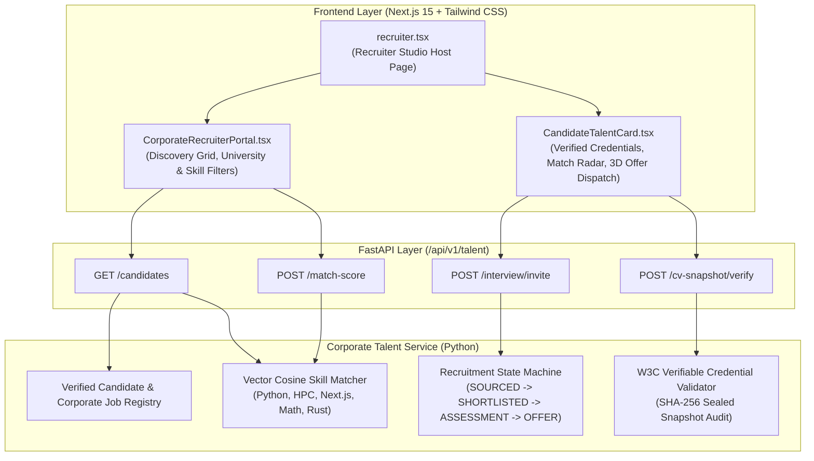

<!--
DEVELOPER ARCHITECTURE NOTE:
MODULE:    Spec-Driven Development (SDD) Technical Plan
TOPIC:     Phase 109 Corporate Talent Acquisition & Cryptographic Skill Pipeline
FILE:      specs/013-phase109-corporate-talent-pipeline/plan.md
PHASE:     Phase 109 - Corporate Talent Acquisition & Cryptographic Skill Pipeline
PURPOSE:   Architectural blueprint for algorithmic skill vector matching,
           cryptographic W3C verifiable skill credentials, sealed CV snapshot immutability,
           and bilateral recruitment stage lifecycle management.
STANDARDS: W3C Verifiable Credentials, Vector Cosine Similarity, Zero-Emoji, UI/UX Pro Max
-->

# Technical Plan: Phase 109 — Corporate Talent Acquisition & Cryptographic Skill Pipeline

## 1. System Architecture

## 2. Skill Vector Definitions
Supported skill taxonomy with standardized normalized dimensions:
- `PYTHON`: Python backend, scientific computing (NumPy/Pandas/FastAPI)
- `HPC`: High-performance computing, CUDA, MPI, parallelism
- `NEXTJS`: React 19, Next.js 15 App Router, TypeScript, Tailwind
- `MATH_MODELING`: Numerical analysis, differential equations, optimization
- `DISTRIBUTED_SYSTEMS`: Microservices, Kafka, WebSockets, Raft
- `MACHINE_LEARNING`: PyTorch, NLP, Computer Vision, IRT modeling
- `RUST`: Systems programming, memory safety, WebAssembly

## 3. Cryptographic Verification Standard
Each candidate has a sealed CV snapshot signed with:
$$\text{Signature} = \text{HMAC-SHA256}(\text{candidate\_id} + \text{cgpa} + \text{institution} + \text{verified\_skills}, \text{SecretKey})$$
Any alteration in CGPA or unverified addition of skills immediately invalidates the signature.

## 4. Design & Typography Tokens
- Tactile 3D button classes: `shadow-[0_4px_0_0_#1D4ED8] active:translate-y-1 active:shadow-none font-semibold rounded-2xl`
- Lucide React SVG vectors only: `Briefcase`, `ShieldCheck`, `Code`, `Award`, `ExternalLink`, `CheckCircle2`, `Filter`, `Sparkles`
- 'Plus Jakarta Sans' for CTC salaries and company titles; 'Hind Siliguri' for job descriptions and student achievements.
