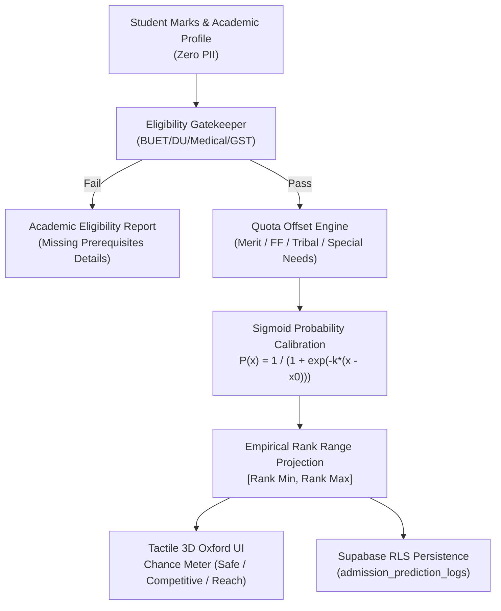

# IMPLEMENTATION PLAN: Phase 128 — Autonomous University Admission Cut-Off Forecaster & Rank Sigmoid Predictor

## 1. Architectural Strategy
Build an institutional-grade, zero-PII admission prediction engine based on empirical 10-year Bangladesh admission metrics and logistic sigmoid probability modeling.

## 2. Directory & Component Layout
- `backend/analytics/`: Dedicated analytics and forecasting package.
  * `backend/analytics/__init__.py`: Package export.
  * `backend/analytics/admission_forecaster.py`: Engine class `AdmissionForecaster`, unit configurations, eligibility logic, sigmoid calculation, rank prediction.
- `backend/migrations/006_admission_forecast_rls.sql`: Supabase table and RLS policies for anonymous & authenticated prediction logging.
- `frontend/src/pages/admission/predictor.tsx`: Next.js interactive prediction interface with Oxford academic theme, 3D tactile buttons, calibrated gauge, and pure Lucide icons.
- `backend/tests/test_phase128_admission_forecaster.py`: Comprehensive test suite verifying mathematical bounds, eligibility gates, quota shifts, zero PII, and zero emojis.

## 3. Milestones & Checkpoints
1. [x] Architectural specifications & tasks definition.
2. [ ] Backend analytics engine implementation (`admission_forecaster.py`).
3. [ ] Supabase RLS database migration script.
4. [ ] Frontend interactive predictor page with pure academic UI.
5. [ ] Automated test suite covering math, gates, security, and styling.
6. [ ] Zero-emoji sweep & full test suite execution (1,440+ tests).
7. [ ] Next.js static build validation.
8. [ ] Executive report generation.
