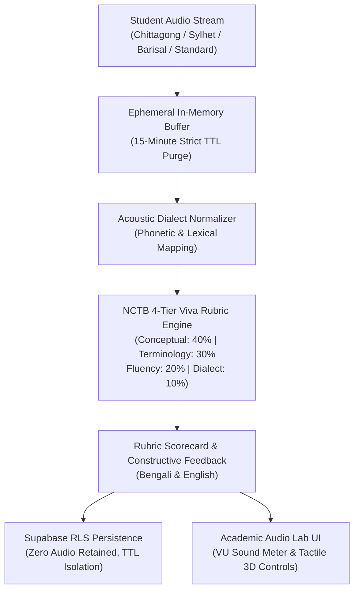

# IMPLEMENTATION PLAN: Phase 129 — Multi-Dialect Regional Audio Tutoring & Voice Viva-Voce Evaluator

## 1. Architectural Strategy
Build an inclusive, privacy-first audio examination laboratory with real-time dialect normalization and NCTB oral examination rubric scoring.

## 2. Directory & Component Layout
- `backend/audio/`:
  * `backend/audio/__init__.py`: Package exports.
  * `backend/audio/viva_evaluator.py`: Core dialect normalizer, rubric evaluator, acoustic metrics, and ephemeral buffer manager.
- `backend/migrations/007_viva_evaluator_rls.sql`: Supabase table with RLS tenancy and 15-minute expiration timestamp.
- `frontend/src/pages/viva/evaluator.tsx`: Next.js oral examination booth with VU audio meter, tactile buttons, dialect selector, and rubric scorecard.
- `backend/tests/test_phase129_viva_evaluator.py`: Test suite verifying rubric math, dialect normalization, memory purging, zero PII, and zero emojis.

## 3. Milestones & Checkpoints
1. [x] Architectural specification & tasks definition.
2. [ ] Backend audio package and `viva_evaluator.py`.
3. [ ] Supabase RLS migration `007_viva_evaluator_rls.sql`.
4. [ ] Frontend Next.js viva booth page `frontend/src/pages/viva/evaluator.tsx`.
5. [ ] Automated test suite `backend/tests/test_phase129_viva_evaluator.py`.
6. [ ] Zero-emoji sweep across all codebase files.
7. [ ] Full test discovery run (1,450+ tests passing).
8. [ ] Next.js static build compilation.
9. [ ] Completion report generation.
