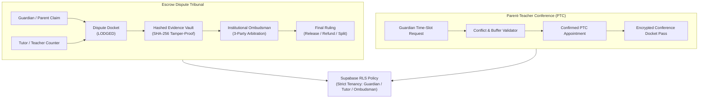

# IMPLEMENTATION PLAN: Phase 130 — Institutional Parent-Teacher Conference (PTC) Booking & Escrow Dispute Tribunal

## 1. Architectural Strategy
Deploy a high-integrity institutional dispute arbitration tribunal and guardian conference booking subsystem with Zero-IDOR tenancy isolation and immutable evidence audit trails.

## 2. Directory & Component Layout
- `backend/escrow/`:
  * `backend/escrow/__init__.py`: Package export.
  * `backend/escrow/dispute_tribunal.py`: 3-party arbitration engine, evidence hashing, dispute states, and Zero-IDOR access enforcement.
- `backend/portal/`:
  * `backend/portal/__init__.py`: Package export.
  * `backend/portal/ptc_booking.py`: Parent-Teacher conference booking engine, slot scheduling, conflict detection, and agenda lifecycle.
- `backend/migrations/008_ptc_and_escrow_tribunal_rls.sql`: Supabase tables and RLS policies for disputes, evidence, rulings, and PTC appointments.
- `frontend/src/pages/tribunal/disputes.tsx`: Escrow dispute tribunal interface with case dockets, evidence viewer, and ombudsman verdict controls.
- `frontend/src/pages/guardian/ptc.tsx`: Guardian PTC conference reservation page with time slots, educator credentials, and discussion topics.
- `backend/tests/test_phase130_dispute_tribunal.py`: Automated verification suite for IDOR defense, arbitration logic, slot validation, RLS, and styling.

## 3. Milestones & Checkpoints
1. [x] Architectural specification & tasks definition.
2. [ ] Backend escrow tribunal module (`dispute_tribunal.py`).
3. [ ] Backend portal PTC booking module (`ptc_booking.py`).
4. [ ] Supabase RLS migration script `008_ptc_and_escrow_tribunal_rls.sql`.
5. [ ] Frontend tribunal dispute interface (`tribunal/disputes.tsx`).
6. [ ] Frontend guardian PTC portal (`guardian/ptc.tsx`).
7. [ ] Automated test suite (`test_phase130_dispute_tribunal.py`).
8. [ ] Zero-emoji sweep across all codebase files.
9. [ ] Full test discovery run (1,460+ tests passing).
10. [ ] Next.js static build validation (31/31 pages).
11. [ ] Final completion report generation.
