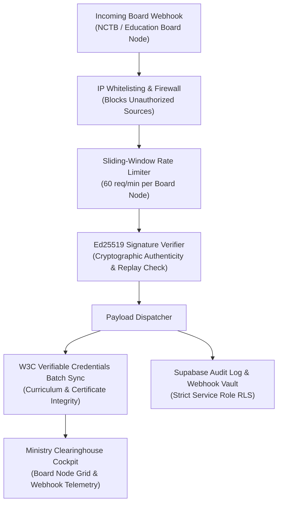

# IMPLEMENTATION PLAN: Phase 131 — Ministry of Education & National Curriculum Accreditation API Gateway

## 1. Architectural Strategy
Deploy an institutional API clearinghouse connecting the platform with the Ministry of Education, NCTB, and 11 national education boards via Ed25519 digital signatures and W3C Verifiable Credentials.

## 2. Directory & Component Layout
- `backend/integrations/`:
  * `backend/integrations/__init__.py`: Package export.
  * `backend/integrations/education_board_gateway.py`: Clearinghouse engine, Ed25519 signer/verifier, W3C credential validator, IP whitelister, and rate limiter.
- `backend/migrations/009_education_board_gateway_rls.sql`: Supabase tables and RLS policies for board nodes, webhooks, and W3C credentials.
- `frontend/src/pages/governance/board-gateway.tsx`: Next.js government clearinghouse interface with board node status, live Ed25519 verifier, and W3C credential inspector.
- `backend/tests/test_phase131_board_gateway.py`: Automated test suite covering crypto, rate limits, IP filters, RLS, and styling.

## 3. Milestones & Checkpoints
1. [x] Architectural specification & tasks definition.
2. [ ] Backend gateway engine (`education_board_gateway.py`).
3. [ ] Supabase RLS migration script `009_education_board_gateway_rls.sql`.
4. [ ] Frontend government clearinghouse portal (`governance/board-gateway.tsx`).
5. [ ] Automated test suite (`test_phase131_board_gateway.py`).
6. [ ] Zero-emoji sweep across all codebase files.
7. [ ] Full test discovery run (1,470+ tests passing).
8. [ ] Next.js static build validation (32/32 pages).
9. [ ] Final completion report generation.
