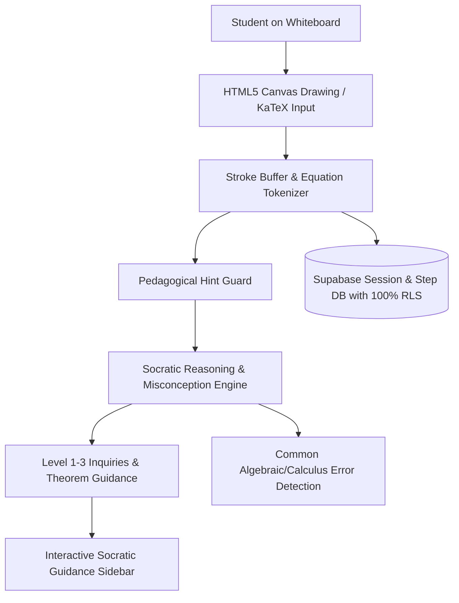

# PLAN: Phase 132 — Real-time Socratic AI Math & Science Whiteboard Solver with Interactive Canvas

## 1. Architectural Strategy
The Socratic Whiteboard Solver bridges interactive freehand scientific sketching with formal mathematical pedagogy. The solver is purposefully restricted from delivering instantaneous terminal solutions; it acts as an Oxford-style tutor posing structured inquiries and validating student deductions.

## 2. Implementation Steps
1. **Backend Package & Socratic Engine**:
   - Write `backend/socratic/__init__.py`.
   - Write `backend/socratic/whiteboard_solver.py` with `SocraticEngine`, `PedagogicalHintGuard`, `MisconceptionDetector`, and `DrawingStrokeBuffer`.
2. **Database Migration with 100% RLS**:
   - Write `backend/migrations/010_socratic_whiteboard_rls.sql` covering `socratic_whiteboard_sessions`, `socratic_step_attempts`, and `socratic_saved_workbooks`.
3. **Frontend Academic Canvas**:
   - Write `frontend/src/pages/socratic/solver.tsx` featuring canvas tools (Pencil, Ruler, Compass, Eraser), KaTeX formula panel, 3D tactile buttons, and Socratic hints drawer.
4. **Automated Test Suite**:
   - Write `backend/tests/test_phase132_socratic_whiteboard.py` asserting header compliance, zero-emoji, hint guard enforcement, misconception detection, stroke serialization, and migration SQL integrity.
5. **Execution & Regression Verification**:
   - Zero-emoji scan across repository.
   - Run Phase 132 tests.
   - Run full 1,475+ backend tests with 0 failures.
   - Next.js production build (`npm run build`).
   - Start Next.js daemon and verify HTTP 200 on `/socratic/solver`.
