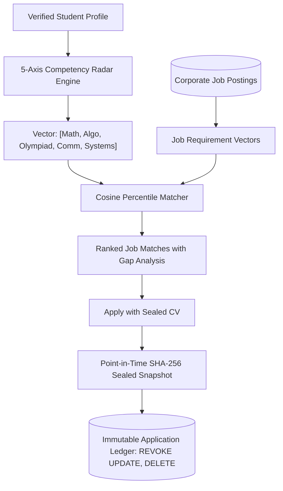

# PLAN: Phase 134 — Algorithmic Skill-to-Job Matching Radar & Recruiter Headhunting Pipeline

## 1. Architectural Strategy
The matching radar translates diverse academic milestones into standardized multi-dimensional competency vectors and compares them with employer requisition profiles.

## 2. Implementation Steps
1. **Backend Package & Skill Matcher**:
   - Write `backend/career/__init__.py`.
   - Write `backend/career/skill_matcher.py` with `CompetencyRadar`, `JobPosting`, `SealedCVSnapshot`, `SkillMatchingService`.
2. **Database Migration with 100% RLS & Immutability**:
   - Write `backend/migrations/012_career_skill_matching_rls.sql` with tables `corporate_job_postings`, `student_skill_radar_profiles`, `sealed_job_applications`, `recruiter_talent_bookmarks`.
   - Apply `REVOKE UPDATE, DELETE ON public.sealed_job_applications` with immutability trigger.
3. **Frontend Academic Recruiting UI**:
   - Write `frontend/src/pages/career/radar.tsx` with interactive SVG radar chart, vacancy match cards, 3D tactile buttons, and sealed CV submission modal.
4. **Automated Test Suite**:
   - Write `backend/tests/test_phase134_skill_matcher.py` verifying headers, zero-emoji, competency radar vector normalization, cosine match ranking, sealed CV SHA-256 hash generation, and migration 012 RLS immutability.
5. **Execution & Regression Verification**:
   - Run zero-emoji sweep.
   - Run Phase 134 test suite.
   - Run full backend discovery (all 1,495+ tests).
   - Compile Next.js production bundle (`npm run build`).
   - Start daemon and verify HTTP 200 on `/career/radar`.
