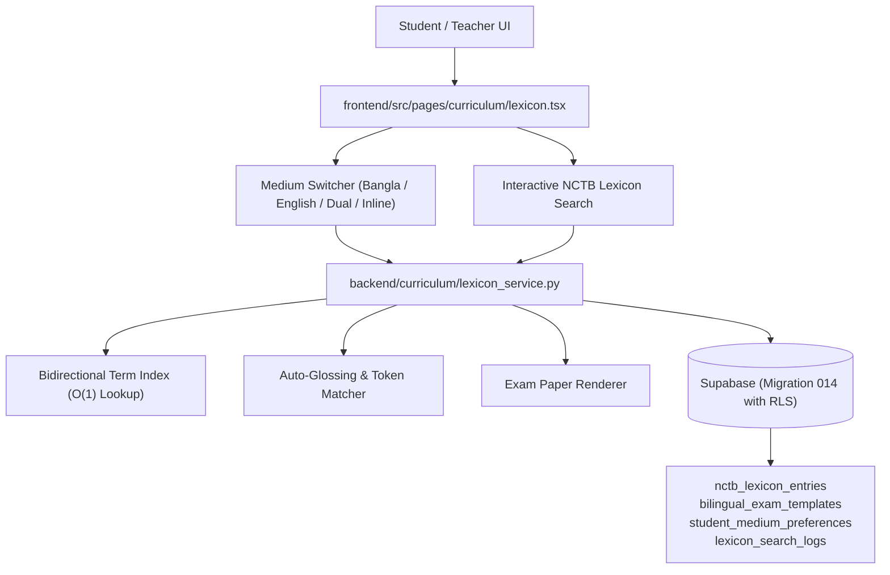

# IMPLEMENTATION PLAN: Phase 136 — Dual-Curriculum English Version / Bangla Medium Auto-Localization Switcher with NCTB Terminology Lexicon

## Architectural Roadmap

---

## 1. Phase Breakdown

### Phase 1: Backend Lexicon Engine & Codecs
- Create `backend/curriculum/__init__.py`.
- Create `backend/curriculum/lexicon_service.py`:
  - Enums: `AcademicMedium` (`BANGLA`, `ENGLISH_VERSION`, `BILINGUAL_DUAL`, `INLINE_ANNOTATED`), `CurriculumSubject` (`PHYSICS`, `CHEMISTRY`, `HIGHER_MATH`, `BIOLOGY`, `GENERAL_SCIENCE`), `GradeLevel` (`SSC`, `HSC`, `ADMISSION`).
  - Dataclasses: `NCTBLexiconEntry`, `BilingualQuestionItem`, `BilingualExamPaper`.
  - Core Service: `NCTBLexiconService`:
    - Seed with authentic NCTB STEM terminology entries across Physics, Chemistry, Higher Math, Biology.
    - Bidirectional lookup: `lookup_by_term(term: str) -> Optional[NCTBLexiconEntry]`.
    - Keyword search: `search_entries(query: str, subject: Optional[CurriculumSubject], grade: Optional[GradeLevel]) -> List[NCTBLexiconEntry]`.
    - Question transformer: `render_question_for_medium(question: BilingualQuestionItem, target_medium: AcademicMedium) -> Dict[str, Any]`.
    - Auto-glossing engine: `annotate_text_with_glossary(text: str, source_lang: str) -> str`.

### Phase 2: Supabase Security & Database Migration
- Create `backend/migrations/014_curriculum_lexicon_rls.sql`:
  - Tables: `nctb_lexicon_entries`, `bilingual_exam_templates`, `student_medium_preferences`, `lexicon_search_logs`.
  - Indexes on terms, subjects, and grade levels.
  - 100% RLS enforcement with `ENABLE` and `FORCE ROW LEVEL SECURITY`.
  - Tenant isolation policies and service role administrative bypass.

### Phase 3: Frontend Dual-Curriculum Console
- Create `frontend/src/pages/curriculum/lexicon.tsx`:
  - Header with Developer Architecture Note.
  - Zero-Emoji design with Lucide vector icons.
  - Typography: `Hind Siliguri` (Bangla) + `Inter` / `Plus Jakarta Sans` (English).
  - 3D tactile push buttons (`shadow-[0_4px_0_0_#051329] active:translate-y-1 active:shadow-none`).
  - View modes: Side-by-Side Dual Column, Single Medium Toggle, Inline Term Annotation.
  - Interactive NCTB STEM Lexicon Search & Filter with subject pills.
  - Interactive Sample Exam Paper Viewer demonstrating instant medium switching.

### Phase 4: Automated Testing & Verification
- Create `backend/tests/test_phase136_lexicon_service.py` with 10+ thorough tests:
  - Header presence & Zero-Emoji verification.
  - Bidirectional dictionary lookup correctness.
  - Subject filtering and search accuracy.
  - Auto-glossing and medium question rendering.
  - Missing term fallback handling.
  - Migration 014 Supabase RLS security.
  - Frontend markup and tactile styling checks.
- Run `backend/scripts/run_zero_emoji_sweep.py` (assert 0 violations).
- Run `python3 -m unittest backend/tests/test_phase136_lexicon_service.py`.
- Run full backend discovery (`python3 -m unittest discover -s backend/tests -p "test_*.py"`).
- Run `npm run build` in `frontend` (assert 37/37 static pages).
- Restart Next.js server daemon and verify `curl -I http://localhost:3000/curriculum/lexicon` (HTTP 200 OK).
- Output comprehensive engineering report artifact `PHASE_136_CURRICULUM_LEXICON_REPORT.md`.
