# IMPLEMENTATION PLAN: Phase 138 — Unified Premium Design for Sub-pages

## 1. Architectural Strategy

```mermaid
flowchart TD
    Tokens["Design Tokens (globals.css)<br/>Oxford Navy (#0A2540) • Paper Ivory (#FAFAF8)<br/>Regal Dark (#090D16) • 3D Tactile Physics"] --> Primitives["Unified UI Primitives (components/ui/)"]
    
    Primitives --> ButtonComp["Button (3D Tactile Physics)"]
    Primitives --> CardComp["Card (Subtle Border & Hover Lift)"]
    Primitives --> InputComp["Input (Tactile Focus Ring)"]
    Primitives --> SelectComp["Select (Custom Accessible Dropdown)"]
    Primitives --> SkeletonComp["Skeleton (Shimmer Loading States)"]
    Primitives --> EmptyComp["EmptyState (Academic Illustrated)"]
    Primitives --> ErrorComp["ErrorState (Dignified Retry Boundary)"]
    Primitives --> HeaderComp["PageHeader (Flagship Editorial Banner)"]
    
    Primitives --> PracticePage["/practice (Adaptive Quiz Arena)"]
    Primitives --> BoardPage["/board-archives (NCTB Question Bank)"]
    Primitives --> ModulesPage["/modules (69 Enterprise Modules Directory)"]
    Primitives --> LearnPage["/learn (Curriculum Hub & Player)"]
    Primitives --> DashboardPage["/dashboard (Student Command Center)"]
```

---

## 2. Execution Phases

### Phase 1: Core Design System Primitives (`frontend/src/components/ui/`)
1. Implement `frontend/src/components/ui/input.tsx` (accessible, focus ring, prefix/suffix icons, error state).
2. Implement `frontend/src/components/ui/select.tsx` (accessible custom select dropdown with chevron and focus ring).
3. Implement `frontend/src/components/ui/skeleton.tsx` (shimmer animation with `prefers-reduced-motion` support).
4. Implement `frontend/src/components/ui/empty-state.tsx` (scholarly empty view with Lucide icon, copy, and button).
5. Implement `frontend/src/components/ui/error-state.tsx` (high-contrast error display with retry action).
6. Implement `frontend/src/components/layout/PageHeader.tsx` (flagship editorial banner with ambient glow, breadcrumbs, and badges).
7. Update `frontend/src/components/ui/index.ts` to export all primitives cleanly.

### Phase 2: Page Rebuilds on Shared Design System
1. **Rebuild `/practice` (`frontend/src/pages/practice.tsx`)**:
   - Integrate `PageHeader`, `Skeleton` for loading, `ErrorState` for failures, and unified `Button` variants.
   - Refactor question cards and option selector to adhere to 3D press physics.
2. **Rebuild `/board-archives` (`frontend/src/pages/board-archives.tsx`)**:
   - Remove divergent local theme state and link directly to global dark/light system.
   - Replace raw inputs/dropdowns with unified `Input` and `Select` components.
   - Integrate `PageHeader` with NCTB seal, breadcrumbs, and print booklet styling.
3. **Rebuild `/modules` (`frontend/src/pages/modules.tsx`)**:
   - Replace raw inline header with unified `Navbar` and `Footer`.
   - Add unified `PageHeader` and style directory cards with unified `Card` and `Badge` components.
4. **Elevate `/learn` (`frontend/src/pages/learn.tsx`)**:
   - Apply `PageHeader`, unified `Tabs`, and tactile chapter navigation cards.
5. **Elevate `/dashboard` (`frontend/src/pages/dashboard.tsx`)**:
   - Standardize page container, background tokens, and tactile metric cards.

### Phase 3: Automated Testing, Zero-Emoji Sweep & Verification
1. Create `backend/tests/test_phase138_unified_design.py`:
   - Validates developer headers across all created/updated files.
   - Strictly enforces Zero-Emoji across the design system and pages.
   - Verifies component exports and interface signatures.
   - Asserts unified dark/light token consistency.
2. Run `python3 backend/scripts/run_zero_emoji_sweep.py`.
3. Run `python3 -m unittest backend/tests/test_phase138_unified_design.py`.
4. Run full backend test discovery (`python3 -m unittest discover -s backend/tests -p "test_*.py"`).
5. Run `npm run build` in `frontend` ensuring all static pages compile cleanly with zero errors.
6. Verify live rendering on port 3000 via curl.
7. Output comprehensive engineering report artifact `PHASE_138_UNIFIED_SUBPAGES_DESIGN_REPORT.md`.
