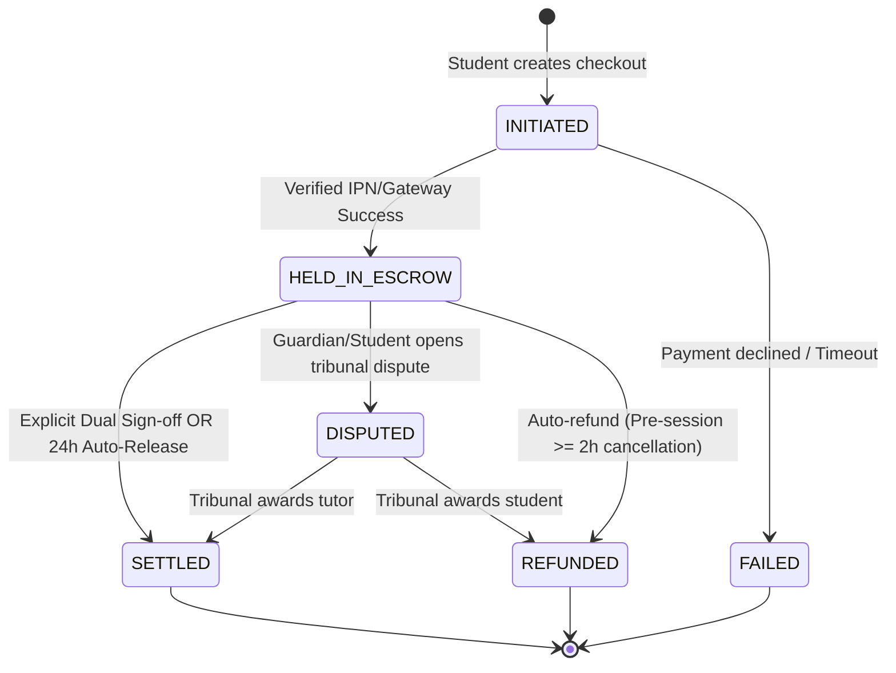

# SPECIFICATION: Phase 140 — National Payment Gateway & Live Security Audit

## 1. Executive Summary & Goal
The goal of **Phase 140** is to implement a battle-hardened, server-authoritative National Payment Gateway and Escrow Infrastructure supporting Bangladesh's primary transaction channels (**bKash**, **Nagad**, and **Card payments via SSLCommerz**), accompanied by an exhaustive **OWASP ASVS Level 2** security audit and lockdown.

All payment amounts, currencies, and transaction states are strictly authoritative on the server. The client is never trusted for financial amounts or payment outcomes.

---

## 2. Developer Architecture Note
Every created or modified file must include the mandatory header:
```typescript
/**
 * DEVELOPER ARCHITECTURE NOTE:
 * MODULE:    National Payment Gateway & Security Lockdown
 * TOPIC:     Phase 140 bKash, Nagad, SSLCommerz Escrow, IPN Webhooks & OWASP ASVS L2 Audit
 * FILE:      [File Path]
 * PHASE:     Phase 140 - National Payment Gateway & Live Security Audit
 * PURPOSE:   [Architectural Purpose]
 * STANDARDS: Zero-Emoji, Zero-IDOR, OWASP ASVS L2, Atomic DB Transactions, Server Authority
 */
```

---

## 3. Clarifications

### Session 2026-10-21
- **Q: Which digital escrow release mechanism should govern the release of tuition and test fees to tutors or institutions?**  
  → **A**: **Hybrid Dual Sign-off with 24h Auto-Release Fallback**. The learner or guardian can release funds immediately upon session conclusion; if no dispute is lodged within 24 hours of scheduled completion, escrow automatically releases to the tutor's balance.
- **Q: How should refund requests be authorized between instant automated refunds and manual administrative review?**  
  → **A**: **State-Gated Hybrid Refund**. Pre-session cancellations (≥ 2 hours prior to start), duplicate gateway IPN captures, or timed-out transactions trigger instant automated refunds. Once a lesson starts or if a dispute is registered, refunds require manual tribunal adjudication.
- **Q: At what frequency should the automated payment reconciliation background job execute?**  
  → **A**: **Hourly Automated Background Job**. Scans and polls official gateway APIs (bKash Query, Nagad Verify, SSLCommerz Transaction Query) for indeterminate or pending transactions older than 15 minutes, synchronizing statuses and emitting discrepancy alerts.
- **Q: How should sandbox testing and live production deployment credentials be managed?**  
  → **A**: **Dual-Mode Environment Configuration**. Official sandbox mock credentials and sandbox URLs operate safely by default; setting live credentials and `PAYMENT_MODE=live` seamlessly engages production banking endpoints without code modifications.

---

## 4. User Stories & Acceptance Criteria

### User Story 1 (P1): Server-Authoritative Multi-Gateway Checkout
**As a** student or guardian paying for a verified tuition package or mock exam bundle,  
**I want to** checkout securely via bKash, Nagad, or Debit/Credit Cards (SSLCommerz) with prices calculated exclusively on the server,  
**So that** my funds are locked safely in escrow and I receive an immutable, verified digital receipt.

- **Scenario 1.1**: Student initiates checkout for Course 101 priced at BDT 1,500. The server creates an escrow invoice with unique UUID `invoice_id` and server-calculated amount `1500.00`. If client attempts to mutate amount in payload to `1.00`, the server ignores or rejects client input and executes payment against server invoice table.
- **Scenario 1.2**: Idempotent Checkout Creation. Every checkout request requires header `X-Idempotency-Key`. Replaying the same key returns the existing initiated session without generating duplicate charges.

### User Story 2 (P1): Cryptographic Webhook & IPN Verification
**As a** platform security engineer,  
**I want** every gateway callback (bKash IPN, Nagad Callback, SSLCommerz IPN) to be cryptographically validated and deduplicated,  
**So that** malicious actors cannot forge successful payment callbacks or replay previously settled transactions.

- **Scenario 2.1**: SSLCommerz IPN payload arrives. System validates `verify_sign` and recalculates SHA256/MD5 hash against `STORE_PASSWD` and transaction parameters. If hash mismatch occurs, callback is rejected and flagged as security incident.
- **Scenario 2.2**: Replay Attack Protection. When an IPN with an already settled `gateway_txn_id` arrives, the system logs the duplicate, returns HTTP 200 to acknowledge the gateway, but does not alter the escrow ledger or disburse funds twice.

### User Story 3 (P2): 24-Hour Digital Escrow Release & Refund State Machine
**As a** tutor or parent,  
**I want** escrow funds to be released upon lesson verification or automatically after 24 hours without disputes,  
**So that** payments are fair, predictable, and protected against unfulfilled obligations.

- **Scenario 3.1**: Guardian signs off on completed lesson → Escrow state transitions from `HELD_IN_ESCROW` to `SETTLED`, crediting tutor payout balance.
- **Scenario 3.2**: 24 hours elapse after scheduled lesson with zero disputes logged → Hourly reconciliation background job detects expiration of dispute window and auto-settles escrow.
- **Scenario 3.3**: Pre-session cancellation ≥ 2 hours prior to scheduled start → Escrow state transitions to `REFUNDED` and refund API triggers gateway reversal.

### User Story 4 (P1): OWASP ASVS Level 2 Security Lockdown
**As a** security officer,  
**I want** complete ASVS Level 2 compliance across input validation, rate limiting, secure headers, CORS, JWT claims, and secret isolation,  
**So that** the payment infrastructure withstands injection, IDOR, SSRF, session hijacking, and CSRF attacks.

---

## 5. Data Models & State Transitions

### Escrow Invoice State Machine


### Core Database Entities
1. `payment_transactions`:
   - `id`: UUID (Primary Key)
   - `idempotency_key`: VARCHAR(128) (Unique)
   - `user_id`: UUID (Foreign Key to users)
   - `gateway`: ENUM (`BKASH`, `NAGAD`, `SSLCOMMERZ`)
   - `gateway_txn_id`: VARCHAR(128) (Unique, Nullable until callback)
   - `amount`: NUMERIC(12, 2) (Server authoritative)
   - `currency`: VARCHAR(3) (Default 'BDT')
   - `status`: ENUM (`INITIATED`, `HELD_IN_ESCROW`, `SETTLED`, `REFUNDED`, `DISPUTED`, `FAILED`)
   - `purpose`: VARCHAR(64) (`TUITION_ESCROW`, `EXAM_FEE`, `CERTIFICATE`)
   - `reference_id`: VARCHAR(128) (Course ID / Booking ID)
   - `auto_release_at`: TIMESTAMP WITH TIME ZONE (Scheduled lesson time + 24 hours)
   - `created_at`, `updated_at`: TIMESTAMP
2. `payment_audit_ledger`:
   - `id`: UUID
   - `transaction_id`: UUID
   - `action`: VARCHAR(64) (`INITIATED`, `IPN_RECEIVED`, `ESCROW_LOCKED`, `DUAL_SIGNOFF`, `AUTO_RELEASE_24H`, `REFUND_ISSUED`, `DISPUTE_FILED`)
   - `actor_id`: VARCHAR(128)
   - `details`: JSONB (Sanitized, zero raw PII / CVV / PIN)
   - `created_at`: TIMESTAMP (Immutable)

---

## 6. Out of Scope
- Storing credit card numbers, CVVs, or cardholder banking passwords on Student Life Circle servers (strictly forbidden by PCI-DSS; delegated to tokenized gateway hosts).
- Manual offline cash payments or untracked bKash P2P "Send Money" without merchant verification.
